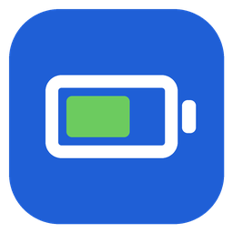

<h1 align="center">BatteryGlance</h1>

  The battery level of your mouse, keyboard, headphones and controllers, right in the Windows taskbar.

  <a href="https://github.com/grundimdev/battery-glance-releases/releases/latest/download/BatteryGlance-win-Setup.exe"><b>Download for Windows 10/11</b></a>

## Features

- **At a glance:** the tray icon shows the device with the lowest battery, color-coded and optionally as a number.
- **All devices in one click:** click the icon for the overview. Earbuds show left, right and case separately.
- **Warned in time:** a notification (optionally with an alarm sound) tells you when a device needs charging, at a threshold you choose.
- **History:** click a device for its battery level over the last days and an estimate of how long the battery lasts.
- **Make it yours:** reorder or hide devices and choose which one the icon shows. Light and dark theme, English and German.
- **For tinkerers:** optionally, the app serves the battery levels as JSON at `http://localhost:47800/api/devices`, e.g. for Rainmeter or Stream Deck.
- **Keeps itself up to date** and starts with Windows.

## Supported devices

| Type | Devices |
| --- | --- |
| Bluetooth in general | Every device whose battery level Windows knows, and devices with the Bluetooth LE battery service |
| Apple | AirPods and Beats (left, right, case), Magic Keyboard, Magic Mouse, Magic Trackpad |
| Earbuds | Samsung Galaxy Buds, Sony WH-/WF-/LinkBuds, Huawei FreeBuds, Google Fast Pair devices (Pixel Buds, OnePlus, Nothing, JBL and more) |
| Logitech | Unifying, Bolt, Lightspeed and Bluetooth; everything Logitech G HUB knows |
| Gaming | Razer (wireless), headsets from SteelSeries, Corsair, HyperX |
| Office headsets | Jabra (Link 380/390, Evolve2), Poly BT600 |
| Controllers | Xbox, PlayStation DualSense and DualShock 4 |

Device not recognized? Right-click the tray icon → **Open diagnostic report**. The report helps to add support for it.

## Install

1. Download [`BatteryGlance-win-Setup.exe`](https://github.com/grundimdev/battery-glance-releases/releases/latest/download/BatteryGlance-win-Setup.exe) and run it. No admin rights needed.
2. Windows SmartScreen may warn because the file is not signed yet: **More info → Run anyway**.
3. The battery icon appears in the notification area of the taskbar (expand it with the `^` arrow if needed).

## Feedback

Found a bug, a device that isn't recognized, or have an idea? [Send feedback](https://github.com/grundimdev/battery-glance-releases/issues/new?template=feedback.yml) (needs a free GitHub account), or use **Send feedback** in the tray menu, which fills in your app and Windows version.

## Settings

The app starts in English; switch to German or your Windows display language under *Settings → Language*. Uninstall via *Settings → Apps*. [Privacy](PRIVACY.md)
